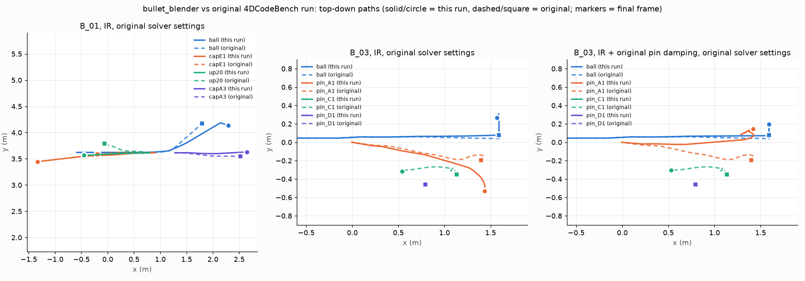

# bullet_blender on 4DCodeBench B_01 / B_03

Adapter: `bullet_blender` (Bullet inside Blender 4.0.2, headless, CPU). It is the same engine as the original 4DCodeBench runs (`4DCodeBench/outputs/2026-11-05/opus-5.5/B_0{1,3}`), so it is the reference point for the cross-backend comparison. B_03 results use the regenerated `examples/codebench/B_03.json` (gutters as 2 cm slabs). B_01 is unchanged.

Timing caveat: four adapter evaluations ran on the same machine at once, so wall-clock times are noisy. Every `simulate()` call starts Blender, which costs about 3-4 s and dominates the process time.

> **Follow-up after this evaluation.** Issue 1 below (the unset collision margin) is fixed in the adapter: `collision_margin` now defaults to 0.001 m. The `bullet/` folder was re-run with the new default:
>
> | case | moved | down | causal max path | causal static | ball err mean / final | body err median | sim (s) |
> |---|---|---|---|---|---|---|---|
> | B_01 | 43/47 | n/a | 1.6 mm | yes | 0.24 / 0.48 m | 0.13 m | 0.42 |
> | B_03 | 8/10 | 8 (C1, D1 up) | 1.3 mm | yes | 0.22 / 0.26 m | 0.19 m | 0.29 |
>
> The "default" rows in the tables below are from the old default (Blender's 0.04 m margin) and are kept to document the issue.

## Configs

| label | settings |
|---|---|
| `bullet` (old default) | dt 1/24/21 s (21 substeps), 10 iterations, no split impulse, `collision_margin` unset (Blender default 0.04 m) |
| `bullet_orig` | B_01: 20 substeps, 40 iterations, margin 0.0008. B_03: 60 substeps, 80 iterations, split impulse, margin 0.002 (the original solver settings) |
| `bullet_damp_orig` | `bullet_orig` plus the original damping, restored in a copy of the IR (`scripts/make_variants.py`): B_01 planks 0.05/0.1, ball 0.02/0.05; B_03 pins 0.05/0.15 |
| `bullet_margin` | old default, but with only the margin set (B_01 0.0008, B_03 0.002): isolates the margin effect |

## Results

Original reference: B_01, 43 of 47 planks move more than 1 cm. B_03, 9 of 10 pins move and 9 are down; D1 stays standing.

Column meanings:
- **moved** counts non-ball bodies; "both" counts bodies that moved in both this run and the original.
- **ball err** is the distance between the centres of the ball in this run and in the original.
- **body err** is the median final-position error of the non-ball bodies.
- **sim** is Blender's stepping loop; **call** is the whole process, for the baseline.

### B_01 (47 planks)

| config | moved (both) | causal static | non-causal = baseline | ball err mean / final | ball err >1 / >5 / >20 cm at frame | body err median | sim / call (s) |
|---|---|---|---|---|---|---|---|
| old default | 43 (42) | yes (1.6 mm) | yes (2e-16) | 0.72 / 1.39 m | 13 / 19 / 28 | 0.33 m | 0.46 / 3.9 |
| margin only | 45 (43) | yes (1.6 mm) | yes | 0.20 / 0.37 m | 19 / 32 / 52 | 0.14 m | 0.36 / 3.9 |
| original settings | 44 (43) | yes (1.4 mm) | yes | 0.23 / 0.50 m | 17 / 31 / 52 | 0.15 m | 0.80 / 3.9 |
| original + damping | 43 (43, same set) | yes (1.5 mm) | yes | 0.32 / 0.81 m | 20 / 29 / 43 | 0.21 m | 0.65 / 3.9 |

### B_03 (10 pins)

| config | moved | down | causal static | non-causal = baseline | ball err mean / final / max | ball err >1 / >5 / >20 cm at frame | body err median | sim / call (s) |
|---|---|---|---|---|---|---|---|---|
| old default | 10 | 10 (D1 too) | **no** (0.85 m; D1 jumps 39 mm in frame 1) | yes | 0.35 / 0.27 / 0.66 m | 21 / 24 / 32 | 0.43 m | 0.30 / 3.9 |
| margin only | 10 | 9 (D1 down, C2 up) | yes (1.2 mm) | yes | 0.08 / 0.08 / 0.12 m | 21 / 23 / never | 0.51 m | 0.30 / 3.9 |
| original settings | 9 | 8 (C1, D1 up) | yes (5 µm) | yes | 0.14 / 0.19 / 0.24 m | 21 / 24 / 74 | 0.37 m | 1.22 / 4.9 |
| original + damping | 8 | 7 (B2, C1, D1 up) | yes (4 µm) | yes | 0.055 / 0.11 / 0.11 m | 21 / 24 / never | 0.26 m | 1.18 / 4.9 |

Contacts are always 0: Blender does not expose contacts.

The old B_03 file, before the gutter fix, failed the causal check in both configs it was run with (1.23 m and 6.43 m). Pins A4 and D1 started 43 mm and 22 mm inside solid gutter blocks (`scripts/b03_initial_overlap.py`). The new file has no initial overlap.

`paths.png` shows top-down x-y paths of this run against the original, for the ball and three bodies.

## Findings

1. **The ball release matches the original exactly.** Before the strike, the ball's B_03 path differs from the original by at most 8e-5 m over the first 12 frames and by less than 1 cm until frame 21, the impact. On B_01 the gap is 2-5 mm over the first 12 frames. The 2-frame animated pre-roll reproduces the original's animate-then-release trick. In the original, the ball stayed kinematic until frame 3 (B_01) or frame 13 (B_03); here it is dynamic from frame 0. That changes nothing visible on the lane and adds a few mm on the B_01 floor before the tower.
2. **The collision margin is the biggest solver-side factor.** Leaving it unset gives every shape Blender's 0.04 m default. Setting only the margin brings B_01 from 0.72 m to 0.20 m mean ball error, the same as the full original settings. It also fixes the B_03 causal check. Substeps and iterations matter much less.
3. **What is left is chaotic divergence, not a systematic bias.** All configs pass the causal and non-causal checks except the old-default B_03. Every run diverges from the original at the first impact (B_01 frames 13-20, B_03 frame 21), starting from a sub-centimetre difference. Restoring the original damping brings B_03 closer (ball error 0.14 m to 0.055 m) but makes B_01 slightly worse (0.23 m to 0.32 m). The outcome categories still agree:
   - B_01 moves 43-45 planks against 43, always including the original 43, and no plank ends up in a different region.
   - B_03 knocks 7-10 pins down against 9, and D1 stays standing whenever the margin is set, as in the original.
4. **Remaining differences from the original that the IR or adapter cannot express:**
   - B_03 pins are cylinders instead of lathe convex hulls: the centre of mass sits 5 cm higher and the base is wider. This most likely explains why C1 stays up in these runs while the original knocks it down.
   - The B_01 planks used Bullet deactivation (sleeping, thresholds 0.05/0.1) in the original. The adapter hard-codes `use_deactivation=False`.
   - The ball release frame differs (finding 1).
   - Original positions are vertex centroids. For pins, the centroid sits 6.1 mm above the cylinder centre, which adds about 6 mm to pin errors.

## Adapter / runner issues

1. **(Fixed: the default margin is now 0.001 m.)** An unset `collision_margin` means a 0.04 m margin, and that breaks contact between a cylinder and thin boxes. Repro, `scripts/margin_repro.py`: a plane (z = 0), the slab `gutter_R_0` (2.3 x 2 cm cross-section, entirely below z = 0, copied from B_03), and pin_D1 copied from B_03.
   - With the margin unset, the pin moves 38 / 70 / 100 mm over frames 1-3.
   - With `collision_margin: 0.002`, it moves 0.01 mm.
   - A box with the same footprint is unaffected, and a cube on its edge rests at the sharp-edge height, so the effect is specific to thin boxes in contact with a cylinder.

   `scripts/d1_pop.py` confirms the cause in the full B_03 causal scene. The jump is identical with the margin unset or set to 0.04. It disappears with a margin of 0 or 0.002, and when `gutter_R*` is removed. Split impulse, 80 iterations and dt 0.000695 do not help on their own; the smaller dt alone makes the jump worse (112 mm).
2. **The non-causal check is satisfied by construction.** `BulletBlenderAdapter.simulate()` replaces the poses of overridden bodies with the input track, so `noncausal_max_diff` (2e-16) only measures quaternion renormalisation. `scripts/raw_noncausal.py` reads the worker's raw output: Blender follows the keyframes exactly (|dpos| = 0 at float32, 1-|q·q'| < 5e-14). So the output is correct, but the check does not test the engine for this adapter.
3. **Deactivation is hard-coded off** (`blender_worker.py`), so the original B_01 plank sleeping cannot be reproduced.
4. **IR (converter), not the adapter:** the slabs `gutter_R_0` and `gutter_L_17` reach |y| = 0.507 m, 2 cm inside the lane edge at 0.527 m. Their top edge is flush with the lane at z = 0, directly under the rims of D1 and A4. They are harmless with a small margin, but they trigger issue 1. Clipping the arc slabs at the lane edge would remove the trigger.

## Verdict

With an explicit small margin, which is now the default, or with the original solver settings, bullet_blender passes the full tuple on both cases. It reproduces the original's outcome categories:
- B_01: 43-44 planks moved against 43.
- B_03: 8-9 pins moved and 7-8 down against 9 / 9, with D1 standing.

The ball path matches the original before impact to under 1 cm (B_03 to under 0.1 mm). After impact, the remaining error (0.05-0.3 m for the ball, 0.13-0.37 m median for the bodies) is chaotic divergence seeded by the cylinder-pin and deactivation approximations. It is not an adapter bug.
