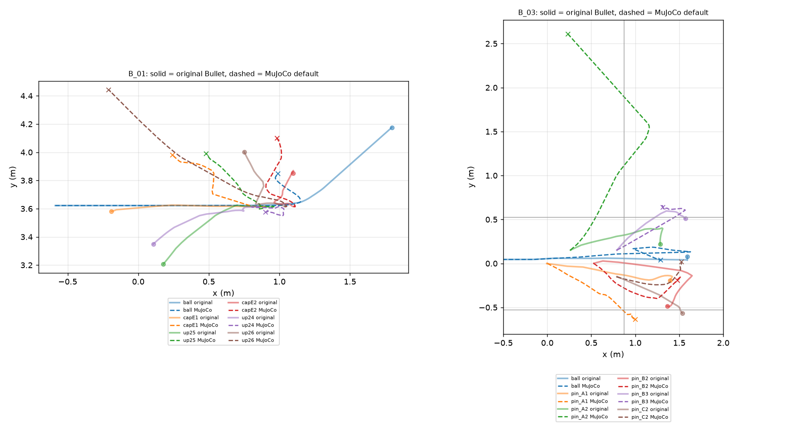

# MuJoCo adapter on 4DCodeBench B_01 and B_03

Adapter `mujoco` (MuJoCo 3.15.0, CPU), runner `vw codebench`, 2026-11-08.
The reference is the original Blender/Bullet run (`4DCodeBench/outputs/2026-11-05/opus-5.5/B_0x`). It is not ground truth.

**Timing caveat:** three other adapter benchmarks shared the CPU and GPU during these runs. The wall-clock numbers are noisy and only good for rough comparison.

## Configs

| label | config | effective dt | steps/frame |
|---|---|---|---|
| `mujoco` | default (Euler integrator, Newton solver, pyramidal cone, contact time constant 0.02 s) | 1.984 ms | 21 |
| `mujoco_rk4` | `{"integrator": "RK4"}` | 1.984 ms | 21 |
| `mujoco_dt0005` | `{"timestep": 0.0005}` | 0.4960 ms | 84 |

The adapter shrinks the requested timestep so that a whole number of steps fits in each 1/24 s frame. That is why 2 ms becomes 1.984 ms. The B_03 results come from the regenerated `B_03.json`, where each gutter is a set of 2 cm slabs on the half-pipe surface.

## Results

How to read the columns:
- **moved:** the body ends more than 1 cm from where it started. The original moved 44 of 47 planks in B_01 and 9 of 10 pins in B_03 (D1 did not move).
- **down:** the pin's axis is tilted more than 45°. In the original B_03, 9 pins went down (A1 A2 A3 A4 B1 B2 B3 C1 C2) and D1 stayed up.
- **err:** final centroid error against the original, over all dynamic bodies plus the ball.
- **moved agree:** bodies, ball included, whose moved / not-moved status matches the original.
- **NC:** the non-causal member (ball removed, every other body replays the baseline).

| case | config | moved | down | causal max path | causal static | NC replays (max diff) | final err mean / median / max (m) | ball path err mean / final (m) | moved agree | sim s base / causal / NC |
|---|---|---|---|---|---|---|---|---|---|---|
| B_01 | default | 44/47 | n/a | 1.8 mm | yes | yes (0) | 0.355 / 0.223 / 1.15 | 0.372 / 0.869 | 47/48 | 3.2 / 3.1 / 1.0 |
| B_01 | RK4 | 46/47 | n/a | 1.1 mm | yes | yes (0) | 0.392 / 0.287 / – | 0.243 / 0.614 | 45/48 | 4.5 / 4.0 / 0.9 |
| B_01 | dt 0.5 ms | 45/47 | n/a | 1.1 mm | yes | yes (0) | 0.315 / 0.209 / – | 0.231 / 0.565 | 44/48 | 9.1 / 11.3 / 3.3 |
| B_03 | default | 9/10 | 9: A1 A2 A3 B1 B2 B3 C1 C2 **D1** | 0.2 mm | yes | yes (0) | 0.671 / 0.471 / 2.61 | 0.352 / 0.305 | 9/11 | 0.6 / 0.7 / 0.3 |
| B_03 | RK4 | 9/10 | 9: same set | 0.1 mm | yes | yes (0) | 0.607 / 0.536 / 1.72 | 0.364 / 0.489 | 9/11 | 1.1 / 1.3 / 0.3 |
| B_03 | dt 0.5 ms | 10/10 | 9: same set | 0.5 mm | yes | yes (0) | 0.665 / 0.508 / 1.92 | 0.302 / 0.205 | 10/11 | 2.0 / 2.6 / 1.1 |

In every run the causal member differs from the baseline by more than 5 cm for 44 to 46 bodies in B_01 and 9 pins in B_03 (`causal_diverges_from_baseline`).

Before the ball hits anything, its path matches the original to within 3.6 mm in B_01 (first 12 frames) and 1 mm in B_03 (first 18 frames).

`paths.png` shows top-down x-y paths of the ball and the five bodies that travel furthest in the original, for the default config against the original.

## Findings

1. **Gutter conversion bug in B_03 (found here, now fixed).** In the first `B_03.json`, the causal member failed `causal_is_static` in all three configs.
   - **Symptom:** with no ball, pin_A4 slid 19 cm (its path peaked at 22 cm), knocked pin_B3 (4.9 cm), and pin_D1 slid 5 to 9 cm.
   - **Cause:** at t = 0, pin_A4 was already 44 mm inside `gutter_L_2` and pin_D1 was 22 mm inside `gutter_R_2`. MuJoCo's soft contact pushed them out over a few frames.
   - **Root cause:** `boxes()` in `examples/codebench/convert.py` assumed every 8 consecutive mesh vertices form a box. The gutter mesh is really a 20-point trough profile at x = −9 and again at x = 0.87. As a result, `gutter_*_2` became solid boxes 9.87 m long that reached onto the lane: to |y| = 0.404 (and up to z = +0.146) on the left, and to |y| = 0.495 on the right. The lane edge is at |y| = 0.527.
   - **This was a scene-IR bug, not an adapter bug,** and it affected every backend.
   - **After the fix:** `scripts/initial_contacts.py` finds no contacts at t = 0, and the causal member stays within 0.1 to 0.5 mm.

2. **Pin outcome (B_03).** The count matches the original: 9 pins down in all three configs, and the same set each time.
   - The difference is which edge pin goes down. The original knocks down A4 and keeps D1 up. MuJoCo keeps A4 up and almost still (it moves 0.1 to 17 mm) and knocks down D1. These two pins are the 2 mismatches in "moved agree".
   - The pins are cylinders: their centre of mass is higher and their base wider than the original lathe-shaped hulls. So matching individual pins should not be expected.
   - Each standing cylinder gets 4 contact points with the lane (`scripts/pin_support_contacts.py`), and none tips over on its own.

3. **Large final errors in B_03 come from one pin that rolls away.** In every config pin_A2 flies over the left gutter and lands on the floor. It then rolls 1.7 to 2.6 m in +y (it ends at y = 1.8 to 2.6 m, z = −0.16). This sets the max error (1.7 to 2.6 m) and raises the mean.
   - The likely reasons are that damping is 0 in the IR and MuJoCo's default rolling friction is close to zero (1e-4), so a lying cylinder barely slows down.
   - In the original, pin_A2 stays near y = 0.2.

4. **Ball path after impact.**
   - **B_01:** in the default config the ball loses most of its momentum in the tower and stops near x = 1.0, which is 0.87 m from the original end point. At dt = 0.5 ms it travels further (0.57 m final error). The spread inside MuJoCo alone, across configs, is about 0.6 m, about the same as the gap to Bullet. The tower collapse is chaotic and sensitive to the timestep and integrator.
   - **B_03:** the ball ends 0.2 to 0.5 m from the original. It hits the pins and reaches the pit 17 to 19 cm ahead of the original at frame 27. It then gets close to the back wall and rolls back toward the lane end (x = 1.1 to 1.4), while the original ball stays at the wall (x = 1.59). Likely reasons are no damping, near-zero rolling friction, and the approximate mapping from restitution to MuJoCo's contact parameters.

5. **Causal settling** (bodies sinking slightly into MuJoCo's soft contact) is small. In B_01 it is at most 1.8 mm, from end caps and uprights (`scripts/causal_motion.py`). In B_03 pins sink 0.2 mm. Both are well under the 1 cm threshold.

## Adapter and runner notes (no fixes applied)

- **The non-causal replay check always passes for this adapter, so it carries no information.** `MuJoCoAdapter.simulate()` records the poses of scripted (mocap) bodies straight from the commanded trajectory (`poses[bid][k] = traj[k]`), not from MuJoCo's simulated state. So `noncausal_max_diff == 0.0` only shows the override was passed through. MuJoCo's scripted bodies do follow their trajectory exactly, so this is not a bug.
- **The non-causal member logs zero contacts.** The B_03 baseline logs 1569 contact events; the non-causal member logs 0. Once every remaining body is scripted, MuJoCo does not compute contacts between bodies that have no degrees of freedom (scripted against scripted, or scripted against static). Anything downstream that reads `SimResult.contacts` for the non-causal member, such as contact-based causal labels, gets an empty list. To reproduce, run the B_03 tuple and look at `noncausal.contacts` in the JSON.
- **Minor:** calling `MuJoCoAdapter({...})` with a dict as the first positional argument fails with `ValueError: {} is not a valid Device`, because the first parameter is `device`. The working form is `MuJoCoAdapter("cpu", **cfg)`.
- **Minor:** the runner computes `down` only for cylinders and capsules, so it is always `n/a` for the B_01 planks.

## Verdict

**B_01: usable.** All tuple checks pass in all three configs. The causal member stays within 2 mm, and 44 to 46 of 47 planks move (the original moved 44). The trajectories after impact are chaotic and change with dt and integrator, so treat them as a plausible alternative outcome, not a reproduction of Bullet.

**B_03: usable on the regenerated scene.** All checks pass in all three configs, the causal member stays within 0.5 mm, and 9 pins go down every time, matching the original count, though with D1 instead of A4. The ball, and the pin that rolls far on the floor, end 0.2 to 2.6 m from the original. Treat those end positions as an engine-specific outcome; adding damping or rolling friction to the IR would be needed to bring them closer.

## Files

- `mujoco/`, `../mujoco_rk4/`, `../mujoco_dt0005/`: runner output, `B_0{1,3}.json` and `B_0{1,3}_poses.npz` for each config
- `paths.png`: top-down paths of the ball and five bodies, default config vs the original
- `scripts/`:
  - `summary_table.py`: builds the results table from the saved JSONs
  - `causal_motion.py`: per-body motion in the causal member
  - `initial_contacts.py`: contacts and penetration depth at t = 0
  - `gutter_boxes.py`: world extents of each gutter slab
  - `pin_support_contacts.py`: contact points under each standing pin
  - `ball_path.py`: ball path against the original, frame by frame
  - `plot_paths.py`: draws `paths.png`
