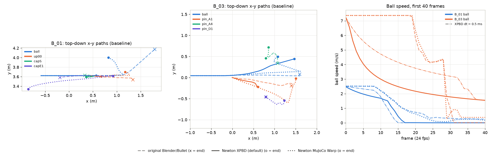

# Newton adapter on 4DCodeBench B_01 / B_03

Newton 1.7.0 on Warp 1.19.0, RTX 4060 Laptop GPU (CUDA) and CPU, run with `vw codebench ... --backend newton`. Four adapter evaluations ran at the same time on this machine, so **wall-clock times are noisy**: the same default B_03 run measured `sim_s` = 7.3 s, 14.6 s and 31.5 s. All B_03 numbers use the regenerated `B_03.json` (gutters as 2 cm slabs on the half-pipe surface).

> **Follow-up after this evaluation.** Adapter issue 1 is addressed. Newton 1.7 cannot build MuJoCo Warp's contact-conversion kernel in Warp's deterministic mode: it raises `WarpDeterminismError` in `convert_newton_contacts_to_mjwarp_kernel`. The adapter therefore now reports `deterministic: false` for `solver="mujoco"` instead of claiming `true`. `iterations` is now reported only for XPBD.

## Configs run

| label | device | config |
|---|---|---|
| `newton` | cuda | default: XPBD, dt 2 ms (1.984 ms, 21 substeps/frame), 8 iterations, deterministic |
| `newton_rerun` | cuda | default, second run (determinism) |
| `newton_cpu` | cpu | default |
| `newton_mujoco` | cuda | `{"solver": "mujoco"}` (MuJoCo Warp) |
| `newton_mujoco_rerun` | cuda | same, second run (determinism) |
| `newton_dt05` | cuda | `{"timestep": 0.0005}` |
| `newton_it32` | cuda | `{"iterations": 32}` |

## Results

Reference (the original Blender/Bullet run):
- B_01: 43/47 planks move more than 1 cm (the runner counts 44/48 when the ball is included).
- B_03: 9 pins down; D1 stays standing.

"Ball err @12" is the largest ball-position error over the first 12 frames, i.e. before or around the first impact. `sim_s` is the stepping time for the baseline only, without JIT.

### B_01 (47 planks)

| config | moved | causal still (max path) | non-causal replay | moved-agreement vs orig | final pos err mean | ball err @12 / mean / final | sim_s |
|---|---|---|---|---|---|---|---|
| default CUDA | 21/47 | **no** (2.2 cm, 12 planks over 1 cm) | yes (0.0) | 26/48 | 0.73 m | 0.21 / 0.80 / 1.35 m | 11.8 |
| default CPU | 21/47 | **no** (2.3 cm) | yes | 26/48 | 0.73 m | 0.21 / 0.81 / 1.35 m | 6.8 |
| dt 0.5 ms | 4/47 | yes (2 mm) | yes | 9/48 | 0.73 m | 0.09 / 0.78 / 1.33 m | 47.3 |
| 32 iterations | 4/47 | yes (3 mm) | yes | 9/48 | 0.73 m | 0.21 / 0.84 / 1.39 m | 49.8 |
| MuJoCo Warp | 46/47 | yes (5 mm) | yes | 45/48 | 0.44 m | **0.004** / 0.40 / 0.99 m | 15.7 |
| MuJoCo Warp rerun | 46/47 | yes (3 mm) | yes | 45/48 | 0.41 m | 0.004 / 0.04 / 0.14 m | 16.3 |

### B_03 (10 pins)

| config | moved | down | causal still | non-causal replay | final pos err mean | ball err @12 / mean / final | sim_s |
|---|---|---|---|---|---|---|---|
| default CUDA | 7/10 | 5 (A1 B1 B2 B3 C2) | yes (2 mm) | yes (0.0) | 0.54 m | 1.31 / 1.72 / 0.38 m | 7.3–31.5 |
| default CPU | 6/10 | 1 (B3) | yes (2 mm) | yes | 0.66 m | 1.31 / 1.75 / 0.50 m | 6.7 |
| dt 0.5 ms | 9/10 | 7 (A1–A4, B1–B3) | yes (1 mm) | yes | 0.47 m | 0.74 / 0.66 / 0.28 m | 58.0 |
| 32 iterations | 6/10 | 1 (B3) | yes (1 mm) | yes | 0.69 m | 1.31 / 1.80 / 0.78 m | 49.3 |
| MuJoCo Warp | 10/10 | 10 (all, including D1) | yes (4 mm) | yes | 0.57 m | **0.000** / 0.44 / 0.66 m | 2.1 |
| MuJoCo Warp rerun | 10/10 | 10 | **no** (1.05 cm, pin_B2 creep) | yes | 0.64 m | 0.000 / 0.34 / 0.45 m | 2.8 |

No configuration records contacts, so the contact count is always 0. `call_s` includes JIT compilation on first use: the first MuJoCo Warp call took 45 s against 16 s of stepping.

`paths_xy.png` shows top-down x-y paths of the ball and three bodies per case, for default XPBD (solid) and MuJoCo Warp (dotted) against the original (dashed). It also plots ball speed over the first 40 frames.

## CUDA vs CPU (default XPBD)

- **B_01:** not bit-identical. Bodies first differ by more than 1 mm at frame 5, while the tower settles. Final positions differ by 2 mm on average and 3.5 cm at most (capS). The outcome is the same: 21/47 moved, and the tower still creeps in the causal member.
- **B_03:** the two devices agree to within 1 mm until the ball reaches the pins at frame 67. After that the chaotic strike diverges: 5 pins down on CUDA vs 1 on CPU. Final positions differ by up to 0.63 m (ball) and 0.58 m (pin_C2), and 6 bodies differ by more than 5 cm. The causal members agree to within 0.02 mm.

CPU stepping was faster than CUDA for these single-world scenes, which are small and run in deterministic mode on the GPU. The timing noise above still applies.

## Determinism

- **XPBD, deterministic=True (default):** `newton` and `newton_rerun` are bit-identical in all three variants for both cases. The comparison was on the saved float32 poses, which are Warp's native precision.
- **MuJoCo Warp:** not reproducible.
  - B_01: the two baselines diverge from frame 8. 44 bodies end more than 5 cm apart, and the ball's final position differs by 1.1 m.
  - B_03: the two baselines diverge from frame 15, and pin_A2 ends 3.8 m apart. In the rerun the causal check flips to fail.

## Findings and causes

1. **XPBD drains energy from a rolling ball (an engine limitation, and the main cause of the mismatch).** Repro: `scripts/rolling_ball.py B_03`, which puts the ball alone on the lane with v = ωr and no damping.
   - XPBD speed: 7.37 → 7.02 (frame 1) → 2.82 (frame 12) → 1.55 m/s (frame 40). The spin decays along with the speed, so the ball keeps rolling.
   - MuJoCo Warp keeps 7.37 m/s. Semi-implicit also keeps the speed, but the ball sinks 2.7 cm into the lane.
   - `{"timestep": 0.0005}` reduces the loss (4.53 m/s at frame 12). `{"iterations": 32}` changes nothing.
   - Setting Newton's default torsional (0.005) and rolling (1e-4) friction to 0 changes almost nothing, on the lane box and on a plane alike (`scripts/rolling_ball_variants.py`).
   - Likely cause (hypothesis): XPBD runs collision detection once per substep, so the contact point stored on the body rotates away with the ball. The position-level friction correction then removes energy, and the loss grows with ωΔt.
   - Effect on B_01: the ball reaches the tower at about 1.7 m/s instead of 2.5 m/s, at frame 12 instead of 8. It pushes out up00–up02, drops capS and stalls in the tower base, so the tower never topples.
   - Effect on B_03: the ball arrives at frame 67 instead of about 20, and the strike is much weaker.
2. **The B_01 tower creeps in the causal member (default XPBD).**
   - The tower geometry is clean: supports touch flush, with at most 0.1 mm AABB overlap (`scripts/tower_gaps.py`).
   - With 8 iterations, XPBD lets the tower drop 2–5 mm in frame 1, then slide sideways at a steady rate of about 0.2 mm/frame. The upper planks reach 2.2 cm by frame 104, so `causal_is_static` fails.
   - 32 iterations (3 mm) or dt 0.5 ms (2 mm) fix it, so the cause is under-convergence, not an initial overlap.
   - Resting B_03 pins show the same effect on a small scale: about 0.01 mm/frame, 1.5 mm in total.
3. **Old B_03 conversion bug (found independently; fixed by regenerating the file).**
   - Each gutter mesh is a 40-vertex extruded U-profile, which `boxes()` in `convert.py` split into consecutive 8-vertex groups.
   - As a result, `gutter_*_2` became solid blocks reaching into the lane (y to 0.404 / −0.495, z up to +0.146). They overlapped pin_A4 by 4.4 cm and pin_D1 by 2.2 cm at t = 0, so both pins were thrown out at frame 1 even with the ball removed (`scripts/static_overlap.py`).
   - With the new file there are no overlaps and the causal member passes.
4. **MuJoCo Warp matches the original best but overshoots on B_03.** All 10 pins go down where the reference keeps D1 standing. Likely causes: the cylinder pins (higher centre of mass, flat base), MuJoCo's soft contacts, and restitution being ignored. Resting pins creep by up to about 1 cm.

## Adapter issues

1. **(Addressed: now reported as `false`.)** `deterministic` was ignored for `solver="mujoco"` but still reported as `true`. Repro: run `vw codebench examples/codebench/B_03.json --backend newton --device cuda --config '{"solver":"mujoco"}'` twice with two labels, then `python docs/benchmarks/codebench/newton/scripts/compare_runs.py diff newton_mujoco newton_mujoco_rerun`. Result: baseline max |Δ| 3.1, first divergence at frame 15.
2. **(Addressed.)** `iterations` was reported in `solver_config` for `mujoco` and `semi_implicit`, although only XPBD uses it.

No runner bugs were found. The non-causal replay is exact (0.0) in every config.

## Verdict

- **Default XPBD:** the tuples are structurally valid. The non-causal replay is exact, the causal member is still on B_03, and on B_01 it is still only with 32 iterations or a 0.5 ms step. But the results are physically far from the original, because XPBD loses rolling energy: the B_01 tower does not topple (4–21 of 47 planks move vs 43), and B_03 has 1–7 pins down vs 9. Not usable as a stand-in for the Bullet outcomes in these ball-driven scenes.
- **MuJoCo Warp:** gives the closest outcomes (B_01 46/47, B_03 10/10 down, ball path exact before impact). But it is not run-to-run deterministic, and resting pins creep by up to about 1 cm, so a tuple can fail `causal_is_static` on one run and pass on another.
- **Recommendation:** usable with caveats. Use `{"solver": "mujoco"}` for realism only where exact reproducibility is not required. Keep XPBD, with `iterations ≥ 32`, only when an exactly reproducible tuple matters more than matching the original.

## Files

- `paths_xy.png`
- `scripts/`: `inspect_causal.py`, `static_overlap.py`, `tower_gaps.py`, `rolling_ball.py`, `rolling_ball_variants.py`, `compare_runs.py`, `plot_paths.py`
- `newton/`, `../newton_rerun/`, `../newton_cpu/`, `../newton_mujoco/`, `../newton_mujoco_rerun/`, `../newton_dt05/`, `../newton_it32/`: each holds the B_01 / B_03 `.json` and `_poses.npz`
