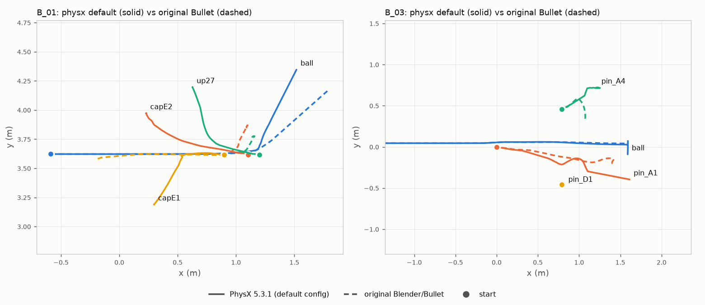

# PhysX adapter on 4DCodeBench B_01 / B_03

The adapter is `physx`: PhysX 5.3.1 through SAPIEN 3.0.3, on CPU. The runner is `vw codebench`, which runs three members per case:
- **baseline**: the full scene.
- **causal**: the ball removed, everything re-simulated.
- **non-causal**: the ball removed, every other body replays its baseline path.

The reference is the original Blender/Bullet run in `4DCodeBench/outputs/2026-11-05/opus-5.5/B_0x`. It is a comparison point, not ground truth.

B_03 was run on the regenerated `examples/codebench/B_03.json`, where each gutter is a set of 2 cm slabs on the half-pipe surface.

**Timing caveat:** four evaluation agents shared the machine, so wall-clock times are noisy. Read them as rough ratios only.

## Configs

| label | config | dt (s), steps per frame |
|---|---|---|
| `physx` | default: TGS, 4 position / 1 velocity iterations, bounce_threshold 0.05, PCM on, no CCD, contact_offset 0.01 | 0.00198, 21 |
| `physx_dt0005` | `{"timestep": 0.0005}` | 0.000496, 84 |
| `physx_pos16` | `{"position_iterations": 16}` | 0.00198, 21 |
| `physx_pgs` | `{"solver": "pgs"}` | 0.00198, 21 |

## Results

Column meanings:
- **moved**: bodies that end more than 1 cm from their start.
- **down**: pins whose axis tilts more than 45°. It is not computed for B_01 planks.
- **causal**: bodies that moved, and the largest path displacement of any body.
- **ball err**: ball-centre distance to the original per frame, as mean / last frame.
- **final err**: mean last-frame position error over all dynamic bodies.
- **sim s**: wall time for baseline / causal / non-causal.

**B_01** (ball topples a 42-plank tower; 47 dynamic planks; reference: 43/47 planks move)

| label | moved | causal: moved / max path | non-causal max diff | ball err mean / final (m) | final err (m) | contact events base / causal | sim s |
|---|---|---|---|---|---|---|---|
| physx | 43/47 | 0 / 0.46 mm | 0 | 0.137 / 0.327 | 0.279 | 7708 / 6449 | 4.8 / 4.5 / 1.3 |
| physx_dt0005 | 44/47 | 0 / 0.20 mm | 0 | 0.171 / 0.534 | 0.259 | 7621 / 6449 | 19.0 / 17.9 / 4.6 |
| physx_pos16 | 44/47 | 0 / 0.20 mm | 0 | **0.089 / 0.238** | **0.210** | 7474 / 6449 | 4.8 / 4.5 / 1.2 |
| physx_pgs | 43/47 | 0 / 1.5 mm | 0 | 0.291 / 0.730 | 0.318 | 7174 / 6449 | 4.6 / 4.5 / 1.2 |

**B_03** (bowling ball strikes 10 pins; reference: 9 down, every pin except D1, which moves but stays standing)

| label | moved | down | causal: moved / max path | non-causal max diff | ball err mean / final (m) | final err (m) | contact events base / causal | sim s |
|---|---|---|---|---|---|---|---|---|
| physx | 10/10 | 8 (A4, D1 standing) | 0 / 1.3 µm | 0 | 0.073 / 0.171 | 0.309 | 1872 / 1290 | 2.0 / 1.2 / 0.4 |
| physx_dt0005 | 10/10 | 10 | 0 / 8.1 mm (pin_C2) | 0 | 0.062 / 0.092 | 0.301 | 2022 / 1290 | 8.5 / 3.9 / 1.5 |
| physx_pos16 | 10/10 | 10 | 0 / 45 µm | 0 | 0.178 / 0.311 | 0.323 | 1991 / 1290 | 1.9 / 1.1 / 0.3 |
| physx_pgs | 10/10 | 10 | 0 / 3.9 µm | 0 | **0.026 / 0.065** | **0.253** | 2380 / 1290 | 1.7 / 0.9 / 0.4 |

All tuple checks pass in all 8 runs:
- `causal_is_static` holds, with the largest causal path under 1 cm.
- `noncausal_replays_baseline` holds bit-exactly: the max diff is 0.0.
- `causal_diverges_from_baseline` is 43 for B_01 and 10 for B_03.
- Moved / not-moved agrees with the original for every body: 48/48 in B_01, 11/11 in B_03.
- Before the first impact (first 12 frames), the ball matches the original to within 3.6 mm in B_01 and 0.02–0.5 mm in B_03.

`paths_xy.png` shows top-down x-y paths: PhysX with the default config as solid lines, the original as dashed. Bodies shown: the ball and the three planks that end farthest from their start in B_01; the ball, pin_A1, pin_A4 and pin_D1 in B_03.

## Findings

### 1. The B_03 gutter overlap is gone
`scripts/b03_initial_overlap.py` steps the scene once with the adapter's own builder:
- The corner pins now sit 0.9 mm clear of the gutter slabs (`pin_A4–gutter_L_17` and `pin_D1–gutter_R_0` both have separation +0.0009 m and zero impulse).
- The causal member stays still to 1.3 µm with the default config.

Before the fix, `convert.py` cut each gutter's single 40-vertex U-profile extrusion into 8-vertex boxes. That produced phantom blocks (`gutter_L_2`, `gutter_R_2`) that overlapped A4 by 4.4 cm and D1 by 2.2 cm at t = 0. Both pins moved without the ball, and D1 fell.

### 2. B_03 pin outcomes: close to the original, but the corner pins differ by config
- **Default:** 8 down. D1 is struck at frame 27, moves 3 cm and stays standing, as in the original. A4 moves at frame 24 and ends upright inside the left gutter channel (z = −0.03, tilt 0°). In the original, A4 is down.
- **dt 0.0005, pos16 and PGS:** all 10 down. D1 ends on the gutter floor.

Whether the corner pins tip depends on the solver settings, which is expected for a chaotic strike. The cylinder-pin approximation makes them easier to tip: the centre of mass is at 0.19 m instead of about 0.14 m for the lathe-turned pin, and the base is wider. PhysX also averages pair materials where Bullet multiplies them.

The ball error is small: 0.026–0.18 m mean. After the strike the ball ends against the back wall of the pit (x = 1.59) in every config, as in the original.

### 3. The PGS ball launch no longer occurs
With the old scene, the ball and pin_A3 overlapped for 7 frames (up to 10 cm) with no contact pair reported. The pair then appeared at separation −0.0997 m, and a 29.6 N·s impulse launched the ball to 4.35 m/s and out of the scene (final error 6.6 m). That run's pin layout came from the bad gutter blocks.

With the corrected scene, PGS is fine:
- The ball never rises above its rolling height (max z 0.109 m).
- After frame 30 its speed stays at or below 0.61 m/s.
- It has the best ball agreement of the four configs: 0.026 m mean, 0.065 m at the end.

The underlying risk remains. The adapter does not set `max_depenetration_velocity`, which is effectively unbounded by default, so any deep overlap turns into a launch rather than a gradual push-out. SAPIEN exposes `set_max_depenetration_velocity` per body.

The repro scripts `scripts/b03_pgs_contact_probe.py` and `scripts/b03_pgs_ball_ejection.py` no longer reproduce the event on the regenerated `B_03.json`. They document the old scene only.

### 4. Slow sliding of resting pins at dt 0.0005
In the `physx_dt0005` causal member, upright, untouched pins slide steadily across the flat lane:

| pin | slide over 5.4 s |
|---|---|
| pin_C2 | 8.1 mm, nearly all in +x |
| pin_A4 | 5.6 mm |
| pin_D1 | 2.1 mm |

There is no tilt and no vertical change. C2 creeps at about 1.4 mm/s. It still passes the 1 cm check, but only just. The default config (1.3 µm) and pos16 (45 µm) do not show it. The likely cause is the convex-mesh cylinder base under PCM with 84 substeps per frame, but this was not isolated.

### 5. B_01 behaves well
- **Without the ball, the tower stays standing:** the largest drift is 0.46 mm over 105 frames (0.2 mm at dt 0.0005 or 16 iterations; 1.5 mm with PGS).
- **Causal contacts are what a resting stack should give:** 62–63 pairs that stay constant over time (cap–upright, upright–floor, loose planks–floor).
- **Baseline:** the first ball contact is plank up00 at frame 9. The baseline has 178 distinct pairs in total, and 43/47 planks move, the same set as in the original.
- **After impact the run drifts from the original:** the ball path is off by 0.14 m on average (0.33 m at the end), and the planks end 0.28 m from their original positions on average. That is normal for a chaotic collapse with a different contact model and material combination rule.
- **Best config:** 16 position iterations matches best (ball error 0.089 m, final error 0.21 m) at the same cost as the default.

### 6. Smaller observations
- **Non-causal logs 0 contact events.** Only kinematic and static bodies remain, and PhysX does not generate kinematic–static or kinematic–kinematic pairs. This is correct for this engine, but downstream code should not expect contacts from non-causal members.
- **dt 0.0005 is not worth it.** It costs about 4× the default wall time and does not improve agreement on B_01. On B_03 it is mixed: better ball error, slightly worse body error.

## Adapter issues
- **Tuple machinery: no bug found.** Kinematic replay is exact, removal works, and axes, units, masses and initial velocities are correct (the ball matches the original before impact).
- **Missing safety parameter:** `max_depenetration_velocity` is neither set nor exposed as a config key. With the old B_03 scene this produced a non-physical launch under PGS: a contact pair missing while the shapes overlapped, then an unbounded push-out. It does not occur with the corrected scene. A two-body version (`scripts/min_repro_sphere_cylinder_cap.py`: the same sphere, cylinder and speed on a plane) never reproduced it; contact there starts normally at a 1 mm gap. The missed contact therefore needs a crowded configuration (the pin also touched the floor box and a curb).
- **Small-dt creep:** see finding 4. Resting cylinders slide by millimetres at dt 0.0005. This is minor, but it would fail a stricter causal threshold.

## Verdict
**Both scenes produce usable tuples with the default config.**
- **B_01:** every check passes in every config; the tower holds without the ball, and 43/47 planks move, matching the original.
- **B_03 (corrected scene):** every check passes in every config. The default causal member stays still to 1.3 µm. Non-causal replays exactly. All 10 pins move. 8–10 pins go down against the original's 9; the corner pins A4 and D1 are the ones that vary by config.
- **Configs:**
  - Use TGS. The default is fine, and `position_iterations: 16` matches B_01 better at no extra cost.
  - PGS is fine on these scenes now, but has no depenetration cap.
  - Avoid dt 0.0005: it is slow, and resting pins creep by millimetres.

## Files
- `B_01.json`, `B_03.json` and their `_poses.npz` files (default config)
- `../physx_dt0005/`, `../physx_pos16/`, `../physx_pgs/`
- `paths_xy.png`
- `scripts/`:
  - `summary_table.py`: builds the results tables from the run JSONs
  - `b03_initial_overlap.py`: first-step contacts of the corner pins
  - `contact_pairs.py`: contact events by pair class
  - `plot_paths.py`: the path figure
  - `b03_pgs_contact_probe.py`, `b03_pgs_ball_ejection.py`: the PGS event, old scene only
  - `min_repro_sphere_cylinder_cap.py`: two-body test, does not reproduce the event
