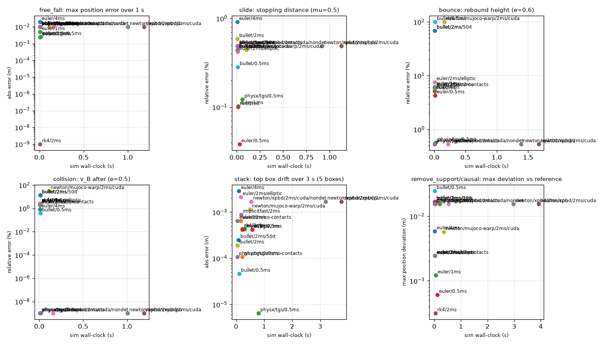

# Physics backend benchmark: results

Generated 2026-11-09T08:19:45+00:00 on Windows 11, AMD64 Family 25 Model 116 Stepping 1, AuthenticAMD, Python 3.12.16. Regenerate with `vw bench`. Interpretation: [README.md](README.md).

## Configs

| Label | Backend | Version | Device | Config | Analytic suite sim time |
|---|---|---|---|---|---|
| mujoco/euler/4ms | mujoco | 3.15.0 | cpu | timestep=0.004 | 0.16 s |
| mujoco/euler/2ms (default) | mujoco | 3.15.0 | cpu | timestep=0.002 | 0.25 s |
| mujoco/euler/1ms | mujoco | 3.15.0 | cpu | timestep=0.001 | 0.42 s |
| mujoco/euler/0.5ms | mujoco | 3.15.0 | cpu | timestep=0.0005 | 0.75 s |
| mujoco/implicitfast/2ms | mujoco | 3.15.0 | cpu | timestep=0.002, integrator=implicitfast | 0.25 s |
| mujoco/rk4/2ms | mujoco | 3.15.0 | cpu | timestep=0.002, integrator=RK4 | 0.33 s |
| mujoco/euler/2ms/elliptic | mujoco | 3.15.0 | cpu | timestep=0.002, cone=elliptic | 0.24 s |
| mujoco/euler/2ms/no-contacts | mujoco | 3.15.0 | cpu | timestep=0.002, record_contacts=False | 0.10 s |
| bullet/2ms | bullet_blender | blender-4.0.2 | cpu | timestep=0.002 | 0.14 s |
| bullet/0.5ms | bullet_blender | blender-4.0.2 | cpu | timestep=0.0005 | 0.24 s |
| bullet/2ms/50it | bullet_blender | blender-4.0.2 | cpu | timestep=0.002, solver_iterations=50 | 0.18 s |
| physx/tgs/2ms | physx | physx-5.3.1.patch0 (sapien 3.0.3) | cpu | timestep=0.002 | 0.34 s |
| physx/tgs/0.5ms | physx | physx-5.3.1.patch0 (sapien 3.0.3) | cpu | timestep=0.0005 | 1.18 s |
| physx/pgs/2ms | physx | physx-5.3.1.patch0 (sapien 3.0.3) | cpu | timestep=0.002, solver=pgs | 0.34 s |
| physx/tgs/2ms/no-contacts | physx | physx-5.3.1.patch0 (sapien 3.0.3) | cpu | timestep=0.002, record_contacts=False | 0.09 s |
| newton/xpbd/2ms/cuda | newton | 1.7.0 (warp 1.19.0) | cuda | timestep=0.002 | 18.29 s |
| newton/xpbd/2ms/cuda/nondet | newton | 1.7.0 (warp 1.19.0) | cuda | timestep=0.002, deterministic=False | 2.49 s |
| newton/xpbd/2ms/cpu | newton | 1.7.0 (warp 1.19.0) | cpu | timestep=0.002 | 15.24 s |
| newton/mujoco-warp/2ms/cuda | newton | 1.7.0 (warp 1.19.0) | cuda | timestep=0.002, solver=mujoco | 1.86 s |

## Analytic suite

Cells: measured value (relative error where the expected value is non-zero).

| Case | Metric | Expected | mujoco/euler/4ms | mujoco/euler/2ms (default) | mujoco/euler/1ms | mujoco/euler/0.5ms | mujoco/implicitfast/2ms | mujoco/rk4/2ms | mujoco/euler/2ms/elliptic | mujoco/euler/2ms/no-contacts | bullet/2ms | bullet/0.5ms | bullet/2ms/50it | physx/tgs/2ms | physx/tgs/0.5ms | physx/pgs/2ms | physx/tgs/2ms/no-contacts | newton/xpbd/2ms/cuda | newton/xpbd/2ms/cuda/nondet | newton/xpbd/2ms/cpu | newton/mujoco-warp/2ms/cuda |
|---|---|---|---|---|---|---|---|---|---|---|---|---|---|---|---|---|---|---|---|---|---|
| free_fall | max position error over 1 s [m] | 0 | 0.0196 | 0.0098 | 0.0049 | 0.0025 | 0.0098 | 1.33e-14 | 0.0098 | 0.0098 | 0.0098 | 0.0025 | 0.0098 | 0.0098 | 0.0025 | 0.0098 | 0.0098 | 0.0098 | 0.0098 | 0.0098 | 0.0098 |
| free_fall | time to drop 1 m [s] | 0.4515 | 0.4495 (0.4%) | 0.4505 (0.2%) | 0.451 (0.1%) | 0.4513 (0.1%) | 0.4505 (0.2%) | 0.4515 (0.0%) | 0.4505 (0.2%) | 0.4505 (0.2%) | 0.4505 (0.2%) | 0.4513 (0.1%) | 0.4505 (0.2%) | 0.4505 (0.2%) | 0.4513 (0.1%) | 0.4505 (0.2%) | 0.4505 (0.2%) | 0.4505 (0.2%) | 0.4505 (0.2%) | 0.4505 (0.2%) | 0.4505 (0.2%) |
| bounce | rebound height (e=0.0) [m] | 0 | 0 | 0 | 0 | 0 | 0 | 0 | 0 | 0 | 0 | 0 | 0 | 0 | 0 | 0 | 0 | 1.49e-09 | 1.49e-09 | 1.49e-09 | 0 |
| bounce | rebound height (e=0.3) [m] | 0.09 | 0.1267 (40.7%) | 0.1308 (45.3%) | 0.1329 (47.7%) | 0.1283 (42.6%) | 0.1308 (45.3%) | 0.1312 (45.8%) | 0.1354 (50.4%) | 0.1308 (45.3%) | 0.0012 (98.7%) | 0 (100.0%) | 0.0012 (98.7%) | 0.0889 (1.3%) | 0.089 (1.1%) | 0.0889 (1.3%) | 0.0889 (1.3%) | 0.0889 (1.3%) | 0.0889 (1.3%) | 0.0889 (1.3%) | 0 (100.0%) |
| bounce | rebound height (e=0.6) [m] | 0.36 | 0.3789 (5.3%) | 0.3812 (5.9%) | 0.3823 (6.2%) | 0.3755 (4.3%) | 0.3812 (5.9%) | 0.3785 (5.1%) | 0.3874 (7.6%) | 0.3812 (5.9%) | 0.1112 (69.1%) | 0 (100.0%) | 0.1112 (69.1%) | 0.3581 (0.5%) | 0.358 (0.6%) | 0.3581 (0.5%) | 0.3581 (0.5%) | 0.3581 (0.5%) | 0.3581 (0.5%) | 0.3581 (0.5%) | 0 (100.0%) |
| bounce | rebound height (e=0.9) [m] | 0.81 | 0.811 (0.1%) | 0.8106 (0.1%) | 0.8109 (0.1%) | 0.8062 (0.5%) | 0.8106 (0.1%) | 0.8077 (0.3%) | 0.8143 (0.5%) | 0.8106 (0.1%) | 0.4001 (50.6%) | 0 (100.0%) | 0.4001 (50.6%) | 0.8077 (0.3%) | 0.8069 (0.4%) | 0.8077 (0.3%) | 0.8077 (0.3%) | 0.8077 (0.3%) | 0.8077 (0.3%) | 0.8077 (0.3%) | 0 (100.0%) |
| slide | stopping distance (mu=0.2) [m] | 1.0194 | 1.0155 (0.4%) | 1.0174 (0.2%) | 1.0185 (0.1%) | 1.019 (0.0%) | 1.0174 (0.2%) | 1.0195 (0.0%) | 1.0175 (0.2%) | 1.0174 (0.2%) | 1.0136 (0.6%) | 1.0149 (0.4%) | 1.0174 (0.2%) | 1.0174 (0.2%) | 1.0189 (0.1%) | 1.0174 (0.2%) | 1.0174 (0.2%) | 1.0174 (0.2%) | 1.0174 (0.2%) | 1.0174 (0.2%) | 1.0174 (0.2%) |
| slide | stopping distance (mu=0.5) [m] | 0.4077 | 0.404 (0.9%) | 0.4059 (0.4%) | 0.4073 (0.1%) | 0.4079 (0.0%) | 0.4059 (0.4%) | 0.4082 (0.1%) | 0.406 (0.4%) | 0.4059 (0.4%) | 0.4053 (0.6%) | 0.4066 (0.3%) | 0.4057 (0.5%) | 0.4058 (0.5%) | 0.4072 (0.1%) | 0.4057 (0.5%) | 0.4058 (0.5%) | 0.4058 (0.5%) | 0.4058 (0.5%) | 0.4058 (0.5%) | 0.4059 (0.4%) |
| stack | top box drift over 3 s (5 boxes) [m] | 0 | 0.0029 | 6.52e-04 | 4.30e-04 | 4.22e-04 | 8.88e-04 | 4.38e-04 | 0.0021 | 6.52e-04 | 1.91e-04 | 4.67e-05 | 2.51e-04 | 1.08e-04 | 6.50e-06 | 4.17e-04 | 1.08e-04 | 0.0017 | 0.0017 | 0.0017 | 0.0011 |
| stack | max penetration (5 boxes) [m] | 0 | 8.74e-04 | 2.04e-04 | 1.34e-04 | 1.34e-04 | 2.56e-04 | 1.34e-04 | 5.93e-04 | 2.04e-04 | 5.53e-05 | 1.47e-06 | 3.19e-05 | 2.99e-05 | 1.44e-06 | 9.37e-05 | 2.99e-05 | 5.76e-04 | 5.76e-04 | 5.76e-04 | 2.73e-04 |
| collision | momentum after (e=1.0) [kg*m/s] | 1 | 1 (0.0%) | 1 (0.0%) | 1 (0.0%) | 1 (0.0%) | 1 (0.0%) | 1 (0.0%) | 1 (0.0%) | 1 (0.0%) | 1 (0.0%) | 1 (0.0%) | 1 (0.0%) | 1 (0.0%) | 1 (0.0%) | 1 (0.0%) | 1 (0.0%) | 1 (0.0%) | 1 (0.0%) | 1 (0.0%) | 0.9233 (7.7%) |
| collision | v_B after (e=1.0) [m/s] | 1 | 1.0004 (0.0%) | 0.999 (0.1%) | 0.9985 (0.2%) | 0.9984 (0.2%) | 0.999 (0.1%) | 0.9983 (0.2%) | 0.999 (0.1%) | 0.999 (0.1%) | 1.0998 (10.0%) | 1.0028 (0.3%) | 1.0998 (10.0%) | 1 (0.0%) | 1 (0.0%) | 1 (0.0%) | 1 (0.0%) | 1 (0.0%) | 1 (0.0%) | 1 (0.0%) | 0.5153 (48.5%) |
| collision | momentum after (e=0.5) [kg*m/s] | 1 | 1 (0.0%) | 1 (0.0%) | 1 (0.0%) | 1 (0.0%) | 1 (0.0%) | 1 (0.0%) | 1 (0.0%) | 1 (0.0%) | 1 (0.0%) | 1 (0.0%) | 1 (0.0%) | 1 (0.0%) | 1 (0.0%) | 1 (0.0%) | 1 (0.0%) | 1 (0.0%) | 1 (0.0%) | 1 (0.0%) | 0.9233 (7.7%) |
| collision | v_B after (e=0.5) [m/s] | 0.75 | 0.7562 (0.8%) | 0.7639 (1.9%) | 0.7676 (2.3%) | 0.7695 (2.6%) | 0.7639 (1.9%) | 0.7694 (2.6%) | 0.7686 (2.5%) | 0.7639 (1.9%) | 0.8498 (13.3%) | 0.7528 (0.4%) | 0.8498 (13.3%) | 0.75 (0.0%) | 0.75 (0.0%) | 0.75 (0.0%) | 0.75 (0.0%) | 0.75 (0.0%) | 0.75 (0.0%) | 0.75 (0.0%) | 0.5153 (31.3%) |
| roll | rolling speed after 1 s [m/s] | 2 | 1.9998 (0.0%) | 1.9998 (0.0%) | 1.9998 (0.0%) | 1.9998 (0.0%) | 1.9998 (0.0%) | 1.9998 (0.0%) | 1.9989 (0.1%) | 1.9998 (0.0%) | 2 (0.0%) | 2 (0.0%) | 2 (0.0%) | 1.9994 (0.0%) | 2.0004 (0.0%) | 1.9996 (0.0%) | 1.9994 (0.0%) | 1.3994 (30.0%) | 1.3994 (30.0%) | 1.3994 (30.0%) | 1.9999 (0.0%) |

## Consistency vs reference (mujoco/rk4/0.25ms (reference))

Max position deviation over all bodies and frames, in meters (worst body in brackets).

| Scene | mujoco/euler/4ms | mujoco/euler/2ms (default) | mujoco/euler/1ms | mujoco/euler/0.5ms | mujoco/implicitfast/2ms | mujoco/rk4/2ms | mujoco/euler/2ms/elliptic | mujoco/euler/2ms/no-contacts | bullet/2ms | bullet/0.5ms | bullet/2ms/50it | physx/tgs/2ms | physx/tgs/0.5ms | physx/pgs/2ms | physx/tgs/2ms/no-contacts | newton/xpbd/2ms/cuda | newton/xpbd/2ms/cuda/nondet | newton/xpbd/2ms/cpu | newton/mujoco-warp/2ms/cuda |
|---|---|---|---|---|---|---|---|---|---|---|---|---|---|---|---|---|---|---|---|
| stack5 | 0.0027 [b4] | 4.83e-04 [b4] | 2.04e-04 [b4] | 8.36e-05 [b4] | 7.27e-04 [b3] | 2.08e-04 [b4] | 0.0018 [b4] | 4.83e-04 [b4] | 4.57e-04 [b3] | 4.23e-04 [b4] | 4.90e-04 [b4] | 3.87e-04 [b4] | 4.19e-04 [b4] | 4.32e-04 [b4] | 3.87e-04 [b4] | 0.0015 [b4] | 0.0015 [b4] | 0.0015 [b4] | 9.75e-04 [b4] |
| bounce_e0.6 | 0.0109 [ball] | 0.0056 [ball] | 0.0088 [ball] | 0.0038 [ball] | 0.0056 [ball] | 0.0042 [ball] | 0.0208 [ball] | 0.0056 [ball] | 0.3702 [ball] | 0.3768 [ball] | 0.3702 [ball] | 0.1762 [ball] | 0.1758 [ball] | 0.1699 [ball] | 0.1762 [ball] | 0.1776 [ball] | 0.1776 [ball] | 0.1776 [ball] | 0.3769 [ball] |
| slide_mu0.5 | 0.0057 [box] | 0.0055 [box] | 0.0026 [box] | 0.0027 [box] | 0.0055 [box] | 0.0029 [box] | 0.0021 [box] | 0.0055 [box] | 0.0028 [box] | 0.0015 [box] | 0.0024 [box] | 0.0023 [box] | 8.88e-04 [box] | 0.0023 [box] | 0.0023 [box] | 0.0023 [box] | 0.0023 [box] | 0.0023 [box] | 0.0055 [box] |
| tumble | 0.791 [b3] | 0.4443 [b3] | 0.2246 [b3] | 0.1214 [ball] | 0.4001 [b3] | 0.0669 [ball] | 0.1101 [b3] | 0.4443 [b3] | 1.0051 [b3] | 0.8915 [b3] | 0.6732 [b3] | 0.386 [b3] | 1.0091 [b3] | 0.6899 [b3] | 0.386 [b3] | 0.8348 [b3] | 0.6466 [b3] | 0.837 [b3] | 0.1598 [ball] |
| remove_support/baseline | 2.24e-04 [support] | 1.20e-04 [support] | 1.26e-04 [box] | 5.46e-05 [box] | 1.20e-04 [support] | 6.15e-05 [support] | 2.47e-04 [box] | 1.20e-04 [support] | 1.45e-04 [box] | 1.16e-04 [box] | 1.17e-04 [box] | 1.18e-04 [box] | 1.17e-04 [box] | 1.17e-04 [box] | 1.18e-04 [box] | 5.78e-05 [box] | 5.78e-05 [box] | 5.78e-05 [box] | 1.84e-04 [box] |
| remove_support/causal | 0.0059 [box] | 0.0024 [box] | 0.0012 [box] | 6.08e-04 [box] | 0.0024 [box] | 3.15e-04 [box] | 0.0024 [box] | 0.0024 [box] | 0.0169 [box] | 0.0246 [box] | 0.0169 [box] | 0.0154 [box] | 0.0154 [box] | 0.0168 [box] | 0.0154 [box] | 0.0154 [box] | 0.0154 [box] | 0.0154 [box] | 0.0057 [box] |

Simulation wall-clock per scene (s):

| Scene | mujoco/euler/4ms | mujoco/euler/2ms (default) | mujoco/euler/1ms | mujoco/euler/0.5ms | mujoco/implicitfast/2ms | mujoco/rk4/2ms | mujoco/euler/2ms/elliptic | mujoco/euler/2ms/no-contacts | bullet/2ms | bullet/0.5ms | bullet/2ms/50it | physx/tgs/2ms | physx/tgs/0.5ms | physx/pgs/2ms | physx/tgs/2ms/no-contacts | newton/xpbd/2ms/cuda | newton/xpbd/2ms/cuda/nondet | newton/xpbd/2ms/cpu | newton/mujoco-warp/2ms/cuda |
|---|---|---|---|---|---|---|---|---|---|---|---|---|---|---|---|---|---|---|---|
| stack5 | 0.106 | 0.173 | 0.298 | 0.601 | 0.177 | 0.232 | 0.164 | 0.046 | 0.050 | 0.107 | 0.086 | 0.224 | 0.817 | 0.233 | 0.037 | 3.758 | 0.541 | 3.166 | 0.488 |
| bounce_e0.6 | 0.006 | 0.007 | 0.009 | 0.013 | 0.008 | 0.009 | 0.007 | 0.005 | 0.009 | 0.012 | 0.009 | 0.008 | 0.022 | 0.008 | 0.006 | 1.673 | 0.224 | 1.428 | 0.169 |
| slide_mu0.5 | 0.008 | 0.011 | 0.018 | 0.037 | 0.013 | 0.016 | 0.012 | 0.005 | 0.008 | 0.012 | 0.010 | 0.020 | 0.069 | 0.020 | 0.005 | 1.241 | 0.168 | 0.994 | 0.132 |
| tumble | 0.063 | 0.097 | 0.167 | 0.309 | 0.097 | 0.134 | 0.094 | 0.032 | 0.034 | 0.073 | 0.053 | 0.139 | 0.488 | 0.129 | 0.024 | 2.504 | 0.371 | 2.130 | 0.521 |
| remove_support/baseline | 0.033 | 0.062 | 0.112 | 0.219 | 0.060 | 0.082 | 0.056 | 0.011 | 0.011 | 0.035 | 0.025 | 0.088 | 0.352 | 0.086 | 0.014 | 4.008 | 0.552 | 3.098 | 0.446 |
| remove_support/causal | 0.019 | 0.030 | 0.053 | 0.109 | 0.032 | 0.042 | 0.027 | 0.008 | 0.006 | 0.016 | 0.011 | 0.047 | 0.198 | 0.046 | 0.011 | 3.919 | 0.531 | 2.976 | 0.356 |

## CPU vs GPU throughput

Scene `tumble` (501 frames), N independent copies. Cells: world-steps per second (simulation only, no contact recording).

| Config | N=1 | N=16 | N=128 | N=1024 | N=4096 |
|---|---|---|---|---|---|
| mujoco/cpu | 30,261 |  |  |  |  |
| physx/cpu | 40,797 |  |  |  |  |
| newton/xpbd/cuda/nondet | 2,571 | 40,828 | 362,575 | 1,659,171 | 2,329,862 |
| newton/xpbd/cuda/det | 399 | 3,241 | 28,000 | 66,569 | 79,811 |
| newton/xpbd/cpu/nondet | 470 | 6,300 | 21,540 |  |  |
